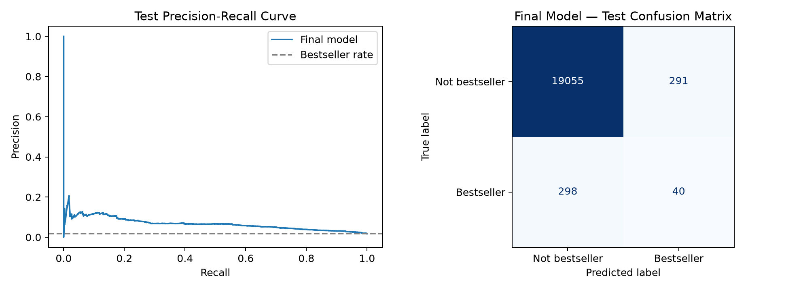

# Amazon Kindle Bestseller Classification

**Logistic Regression from Scratch | PySpark | Python**  
**PDAN8412/w — Programming for Data Analytics 2 | Portfolio of Evidence: Part 2**

## The question

Can a publisher use book characteristics to identify titles associated with bestseller status?

I examined **133,102 Amazon Kindle listings** using Apache Spark for data analysis and an original Logistic Regression implementation in NumPy. The dataset records Amazon's bestseller designation at collection time. This is **retrospective classification**, not a verified forecast of future book sales.

## Dataset

**Source:** [Amazon Kindle Books Dataset 2023 (130K Books)](https://www.kaggle.com/datasets/asaniczka/amazon-kindle-books-dataset-2023-130k-books)

| Measure | Value |
|---|---:|
| Listings | 133,102 |
| Source columns | 16 |
| Bestsellers | 2,236 (1.68%) |
| Training / validation / test | 93,390 / 20,028 / 19,684 |
| Model features after preprocessing | 34 |

The source CSV is not included in this repository. Download `kindle_data-v2.csv` from Kaggle to reproduce the analysis.

## Approach

1. **Evaluate data quality:** Missing dates, extreme values, class imbalance and potential duplicate editions.
2. **Explore training data with PySpark:** Category, price, publication year and Kindle Unlimited availability.
3. **Prepare features:** Group-aware data split; training-only imputation, scaling and category encoding.
4. **Build Logistic Regression from scratch:** Stable sigmoid and cross-entropy, analytical gradients and full-batch gradient descent, checked against numerical gradients.
5. **Test improvements:** Decision threshold, class weighting, L2 regularisation and training duration using validation data.
6. **Evaluate once on the held-out test set:** Precision-recall analysis, confusion matrix and classification metrics.

The Logistic Regression estimator itself does **not** use scikit-learn's prebuilt classifier. Scikit-learn supports preprocessing and evaluation.

## Independent test results

| Metric | Value |
|---|---:|
| Test books | 19,684 |
| Actual bestsellers | 338 |
| Accuracy | 97.01% |
| Average precision | 0.0665 |
| ROC-AUC | 0.8039 |
| Bestseller precision | 12.08% |
| Bestseller recall | 11.83% |
| Correctly identified bestsellers | 40 |
| Missed bestsellers | 298 |
| Incorrectly flagged non-bestsellers | 291 |

The model detects some useful patterns, but **misses most bestsellers** and produces many false positives. It may inform exploratory screening; it is **not reliable enough for independent publishing decisions**.



## Project files

```text
notebooks/              Jupyter notebook with code, analysis and references
outputs/figures/        Saved exploratory and model-evaluation figures
report/                 Final PDF report
data/raw/                Local dataset (excluded from Git)
README.md               Project overview
environment.yml         Reproducible Python environment specification
```

## Reproduce the notebook

1. Clone this repository.
2. Create a Conda environment: `conda env create -f environment.yml`.
3. Activate it: `conda activate pdan8412-part2`.
4. Ensure Java 21 is installed and configured for PySpark.
5. Download the dataset from the Kaggle link above, then place `kindle_data-v2.csv` in `data/raw/` (create these folders if necessary).
6. Open a terminal in `notebooks/` and start JupyterLab with `jupyter lab`.
7. Open `ST10356048_Part2_Logistic_Regression.ipynb` and run all cells from a fresh kernel.

**Note:** The notebook resolves its project root from the parent of the current working directory, so launch JupyterLab from `notebooks/`.

## Limitations and research integrity

Recorded price and Kindle Unlimited availability may have changed after publication; publication dates are often missing; and bestseller labels do not establish future commercial outcomes. Related editions were grouped where identifiable, but not every shared work can be guaranteed to have been detected. The notebook includes research references and an AI-assistance acknowledgement.
